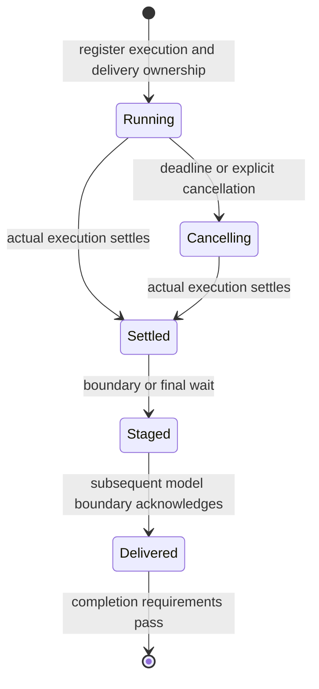

# Programmatic execution and owned background work

The local runtime now offers compact and hybrid programmatic profiles, recoverable process output, optional plain file reads, and run-owned background commands. These are opt-in library capabilities except for output recovery and caller-policy enforcement, which also protect existing local tools. Existing default tool profiles remain available.

The profile targets workflows where one program can paginate, fetch independent records, transform data, and return concise evidence. It can eliminate model turns between deterministic operations. It also adds script generation and discovery overhead, so ordinary edits may be better served by direct tools. The [frozen development comparison](/mnt/reflink/work/deepswe/research/implementation-2026-10-31/manifest.json) measures the complete interface package. It does not isolate the runner or measure background work.

## Compact profile

`createLocalProgrammaticProfile` returns `tools`, `toolRegistry`, `toolExecution`, and `instructions`. Pass the first two and the instructions to the agent or legacy graph configuration; pass `toolExecution` to `Run.create`. A host should preserve its own task and policy instructions when composing the supplied guidance.

```ts
const profile = createLocalProgrammaticProfile({
  local: { cwd: workspace, toolResultMaxChars: 12_000 },
  tools: connectorTools,
  toolRegistry: connectorRegistry,
});

const run = await Run.create({
  runId,
  graphConfig: {
    type: 'standard',
    llmConfig,
    tools: profile.tools,
    toolRegistry: profile.toolRegistry,
    instructions: profile.instructions,
  },
  toolExecution: profile.toolExecution,
  returnContent: true,
});
```

The default outer surface consists of `tool_search` and `run_tools_with_code`. Selected local implementations and supplied connector tools are deferred and callable only from code. Supplied connectors need a canonical schema and an explicit `code_execution` caller permission; omitted permissions retain their normal direct-only meaning and cause profile construction to fail. The factory copies definitions without mutating the supplied registry.

Discovery returns complete canonical schemas as compact JSON. It activates selected implementations without adding their schemas to the outer tools or rewriting the opening instructions. Programs declare every nested tool in `tool_manifest`; discovery must finish before the program starts. Ordinary Bash work can use the runner with an empty manifest, avoiding unnecessary discovery. Each program starts a fresh interpreter; workspace files retain intermediate data.

Caller enforcement covers ordinary tool invocation, event dispatch, eager streaming dispatch, and prepared subagent starts. Hidden schemas alone do not authorize or prevent execution. Undiscovered, disabled, and code-only tools are rejected on the direct path before their implementation or external dispatcher runs.

## Per-agent guidance

Each `AgentInputs` can set `programmaticToolInstructions` to `inline`, `discovery`, or `hybrid`. This overrides the run-wide instruction style for that agent only. Omitting it retains the run-wide setting. Child preparation preserves each child's own choice, including self-spawn and lazily resolved inputs.

This field controls prompt guidance, not execution or caller permissions. Use discovery guidance only when that agent has an available search tool returning complete callable schemas. It lets a compatible parent keep compact guidance while a child without discovery retains inline schemas. Discovery can add a search turn for small catalogs, so smaller request bodies alone do not establish lower cost or faster completion.

## Bounded initial catalog

For large connector libraries, set `maxCatalogChars` on `createLocalProgrammaticProfile` or `createToolSearch`. It must be an integer of at least 128. Omitting it retains the full initial name listing. The limit applies to the catalog section in the search tool's description, not the complete request or search results.

```ts
const profile = createLocalProgrammaticProfile({
  mode: 'hybrid',
  maxCatalogChars: 2048,
  local: { cwd: workspace },
  tools: connectorTools,
  toolRegistry: connectorRegistry,
});
```

If the complete listing fits, it remains visible. Otherwise the initial description contains the total tool/group counts and complete group names where space permits, explicitly stating that tool names were omitted. The complete eligible catalog remains searchable by name and description; discovery still returns canonical invocation schemas. Long server names are omitted as a whole. The preview is built when the tool is created, preserving stable bound schemas after discovery.

This removes unused names from initial tool-schema context without a summarizer or additional catalog request. It does not reduce index construction, cap returned schemas or guarantee fewer discovery calls. Less initial capability visibility can hurt tool selection, so the option remains disabled by default pending workload-specific quality and cost measurements. Hosts using the remote Code API can pass the option to their existing search factory; they should preserve their current executor.

## Automatic operation-level choice

Set `mode: 'hybrid'` on the same factory to let the current model choose direct calls or programs as part of its ordinary tool selection:

```ts
const profile = createLocalProgrammaticProfile({
  mode: 'hybrid',
  local: {
    cwd: workspace,
    codingToolNames: ['read_file', 'write_file', 'edit_file', 'grep_search', 'bash_tool'],
  },
  tools: connectorTools,
  toolRegistry: connectorRegistry,
});
```

The selected local tools are available immediately, both directly and inside `run_tools_with_code`. Connector implementations remain deferred and callable only from code after discovery. The outer tool schemas and system guidance remain stable after discovery. There is one runner, no classifier request, no second agent, and no host rule that predicts whether an arbitrary operation is simple.

The guidance favors direct calls for isolated reads, edits, commands, and investigation requiring judgment after each result. It favors programs for predictable loops, dependent connector operations, and batches where filtering intermediate results helps. Both paths use the same implementations, workspace, caller checks, and execution limits. Existing host permission hooks still apply. Background execution remains an explicit host integration and tool action.

`codingToolNames` selects local primitives only. Omit it for the default local set, or supply `[]` for no local primitives. The factory always adds one runner and search. Unknown names, explicit runner names in this list, and connectors using reserved local names are rejected. Supplied registry metadata for a selected local tool must permit the profile's required callers; hybrid also rejects deferred local metadata. Construction fails on incompatible policies instead of widening them. Canonical local schemas stay authoritative, and supplied definitions are not mutated.

Hybrid exposes more initial schema context than compact. It can still choose unnecessary scripts, split useful batches, or filter away useful evidence. The offline integration fixture scripts the model responses: it proves that direct file and shell calls, an immediate nested local call, discovery, and a dependent connector program work together with no hidden routing request. It does not prove autonomous selection quality or a performance improvement.

The `lcr-hybrid-profile` benchmark variant enables `programmaticHybrid` alongside the same inference, output, step, and verification settings as the existing compact control. A [six-run frozen pilot](/mnt/reflink/work/deepswe/research/hybrid-pilot-2026-10-31/README.md) passed independent and host verification in all arms. Hybrid chose a program for CI connector calls and direct tools for debugging. It reduced CI full CLI time by 27% relative to direct, but increased debugging time by 10% and native input by 96%. This is one attempt per arm on two known development tasks, and does not justify a general default. Archived compact-only results do not measure hybrid.

## Data and presentation

Programs can keep full structured tool results in memory or workspace artifacts and print only the evidence needed for the next decision. `read_file` accepts `line_numbers: false` for machine-readable text while retaining its existing bounded windows. Numbered output remains the default.

With positive `local.toolResultMaxChars`, text reads now return a continuation cursor when content remains, including within a long line. Call `read_file` again with the same `path` and `cursor`, omitting `offset`. Each call resolves current workspace permissions and checks a SHA-256 digest of the captured file bytes. An edited file invalidates the cursor; restart the read. This is a content check, not a workspace revision, an atomic filesystem snapshot or retained historical content.

For exact UTF-8 reconstruction, use `line_numbers: false`, remove only the final `\n[continue with cursor=...]` notice from each incomplete page, and concatenate the bodies. These pages preserve original newlines, CRLF, BOM and complete Unicode characters. Invalid UTF-8 is rejected on this path. Complete small results have no notice, so JSON remains directly parseable. A direct tool-call artifact also provides `recovery.sha256`, half-open `start`/`end` UTF-16 positions, `bodyChars` and optional `nextCursor`.

The managed local ToolNode reserves room for the cursor within its own result cap, including when checkpointing is enabled. Standalone factories accept `createLocalReadFileTool(config, { maxResultChars })` or `createLocalCodingTools(config, { maxReadResultChars })` when a host has a smaller outer cap. A cap too small for a source character or the required cursor fails explicitly. Later host hooks, program stdout formatting or history compaction can still rewrite output; programs should consume nested pages before printing a concise result. The default uncapped reader and attachment behavior are unchanged.

There is no source snapshot cache: every continuation reads and hashes the file again, subject to `maxReadBytes`. This prevents silently mixing different file contents but adds local I/O and hashing. It does not prevent filesystem changes during an individual read. The mechanism makes omitted source recoverable; local tests do not establish fewer model calls, higher task quality or lower total cost.

Set `local.programmaticResultMaxChars` to give the outer program a separate stdout/stderr budget while nested tools retain `local.toolResultMaxChars`. For example, `local: { cwd: workspace, toolResultMaxChars: 12000, programmaticResultMaxChars: 2000 }` lets a program parse larger intermediate results and returns a smaller observation to the model. This applies to both local programmatic runners and the Python and Bash runtimes. It does not increase nested tools' existing read, byte or result limits.

The option accepts a nonnegative safe integer. Omitting it preserves the existing shared limit; zero disables only the outer combined character cap. `maxOutputChars` and `maxSpawnedBytes` remain independent limits. Omission notices, status and recovery metadata are additional to the character budget, so it is not a strict bound on the complete tool message. Post-tool hooks and generic context limits can also change the final message.

This budget applies before the result first enters conversation history. It reuses capture and formatting instead of rewriting old cached observations, but shorter output can hide relevant evidence and require another tool call. Keep programs' own filtering as the first choice. The option remains disabled by default, and offline recovery checks do not establish better task quality, latency or billed cost. The current option is for the local executor; remote Code API integration needs its own artifact-access contract.

The process engine begins capture at the actual presentation threshold, including a smaller combined tool-result cap. It records both streams in decoded arrival order and preserves split UTF-8 characters. Direct tools and programmatic success/error results carry the capture path and execution status outside the capped text. Background results carry those fields separately from their bounded `output` field.

Artifacts use private permissions and exclusive filenames. A timed-out, signalled, or byte-limit-killed command has incomplete captured output; the path does not prove successful completion. Failed capture creation or writing is disclosed. A custom spawn backend receives a host-capture marker because its execution filesystem may differ from the host filesystem. Hosts need an authorized artifact-retrieval path in that deployment and a retention policy for these temporary files. The library does not currently delete captures on a timer.

## Owned asynchronous commands

`createOwnedJobManager` tracks deterministic work under one run. It bounds concurrent commands, total retained jobs, command duration, and model-visible result size. `createLocalBackgroundTools` supplies `start_owned_command` and `cancel_owned_command`, with canonical schemas suitable for the compact profile.

```ts
const jobs = createOwnedJobManager({
  runId,
  gate,
  signal: runAbort.signal,
  maxConcurrent: 2,
  maxJobs: 16,
  maxDurationMs: 60_000,
  maxResultChars: 2_000,
});
const background = createLocalBackgroundTools(jobs, { cwd: workspace });
const unregister = jobs.register(hooks);
const profile = createLocalProgrammaticProfile({
  local: { cwd: workspace },
  tools: background.tools,
  toolRegistry: background.toolRegistry,
});

try {
  // Construct and execute the Run using the same runId, hooks, and profile.
  await executeRun({ runId, hooks, profile });
} finally {
  await jobs.closeAndDrain();
  unregister();
}
```

Here `executeRun` stands for the host's existing `Run.create` and stream consumption. The manager's `register` installs the completion gate as well as delivery hooks; do not also call `gate.register` on that registry for the same run. Supply actual completion requirements and verifiers through the gate.



Results enter the conversation at a tool boundary. If the foreground task finishes first, the Stop hook waits on actual execution and requests a bounded continuation containing completed results. No polling tool is needed. A separate delivery obligation prevents the completion gate from declaring success before results are acknowledged. Exhausted continuations and competing stop decisions retain undelivered results for the host.

Cancellation requests do not release capacity or verification ownership until the command actually settles. Closing an individual programmatic bridge does not cancel work owned by its run. The host must drain the manager in `finally`, including error and abort paths. The manager is in-memory and does not provide cross-process resurrection. Arbitrary host executors must honor cancellation and provide their own full-output recovery when returning truncated data.

Use background execution only for independent work. The runtime does not infer filesystem read/write sets or prevent races between commands. Cancellation preserves already-completed side effects. Within open admission, an identical operation ID and fingerprint returns its existing result; different inputs under that ID fail. Completed records count toward the per-run job limit.

## Existing mechanisms retained

The implementation uses the existing caller projections, runnable binding caches, token accounting, provider prompt-cache support, programmatic bridge, cancellation lifecycle, hook system, execution ledger, and completion gate. It adds no planner model, summarizer model, automatic specialist swarm, persistent interpreter, or second cache hierarchy. This keeps potential savings tied to fewer model decisions and smaller results instead of additional inference.

Current verification covers real local processes, failure and truncation boundaries, nested programmatic calls, the actual outgoing HTTP model binding, cancellation/draining, real Run continuation behavior, and tracing regressions. The live Langfuse project check is unavailable in this environment. See the [validation record](/mnt/reflink/work/deepswe/research/implementation-2026-10-31/validation.json).

## Integration and publication

The remote LibreChat host patch is now prepared in `/home/berry13/orca/workspaces/librechat/feat-compact-programmatic-harness`. It reuses the existing remote Bash programmatic runner and preserves Code API routes, sessions, workspace selection and capability controls. A shared search factory returns complete canonical schemas on both initial and event-dispatched paths, including non-deferred code-only tools. Discovery instructions apply only when all known programmatic agents are compatible; unresolved lazy children and incompatible runners retain inline instructions. Do not attach `createLocalProgrammaticProfile` to the API host as a replacement for a remote workspace.

The host patch passed scoped lint and 79 targeted tests against the local feature SDK. It requires those SDK features to be released; published agents 4.1.1 does not implement schema-bearing discovery. Full host typechecking remains blocked by four stale built-package exports in untouched auth files. No live remote Code API or Langfuse verification has run. The [integration report](/mnt/reflink/work/deepswe/research/integration-2026-10-31/README.md) records exact source, commands, environment limitations and the remaining trusted-verification work.

A separate six-run local-executor diagnostic on fresh-to-this-campaign lots/FEFO, tooling-recovery and migration tasks passed both arms. Compact reduced observed full CLI time by 12.0%, 21.2% and 1.9%, respectively. Each task used the same number of model requests in both arms, and estimated cost increased on two tasks. One attempt per arm and uncontrolled gateway/cache variation do not establish a causal speedup or a new default. These local measurements do not measure the remote host patch.

The [completed twelve-run development comparison](/mnt/reflink/work/deepswe/research/implementation-2026-10-31/comparison-v2/REPORT.md) passed independent grading in both arms on three tasks with two repetitions each. The compact profile reduced mean full CLI time by 34% and native input tokens by 50% on structured CI triage. It increased mean full CLI time by 9% on debugging and 13% on imports. This supports selective use, not a universal default or a broad quality claim. Owned background commands were disabled in this comparison.

Keep both profiles opt-in until broader tasks justify a default change. Hybrid is the next candidate for mixed coding and connector workflows because it retains direct feedback while allowing composition within the same run. Introduce output recovery and permission fixes first, then profile/discovery/plain reads, then owned jobs in hosts that can guarantee cleanup and artifact access. Preserve stable trace names, nested usage attribution, and per-run budget accounting through each stage.

The worktree contains earlier verification and budget work as well as this implementation. Publish reviewable units for recovery, caller/profile behavior, owned jobs, and benchmark tooling/results; do not combine the entire dirty tree into one PR. The [research architecture note](/mnt/reflink/work/deepswe/research/programmatic-execution-2026-10-30/performance-architecture.md) records the public-source evidence and limits behind these choices.
