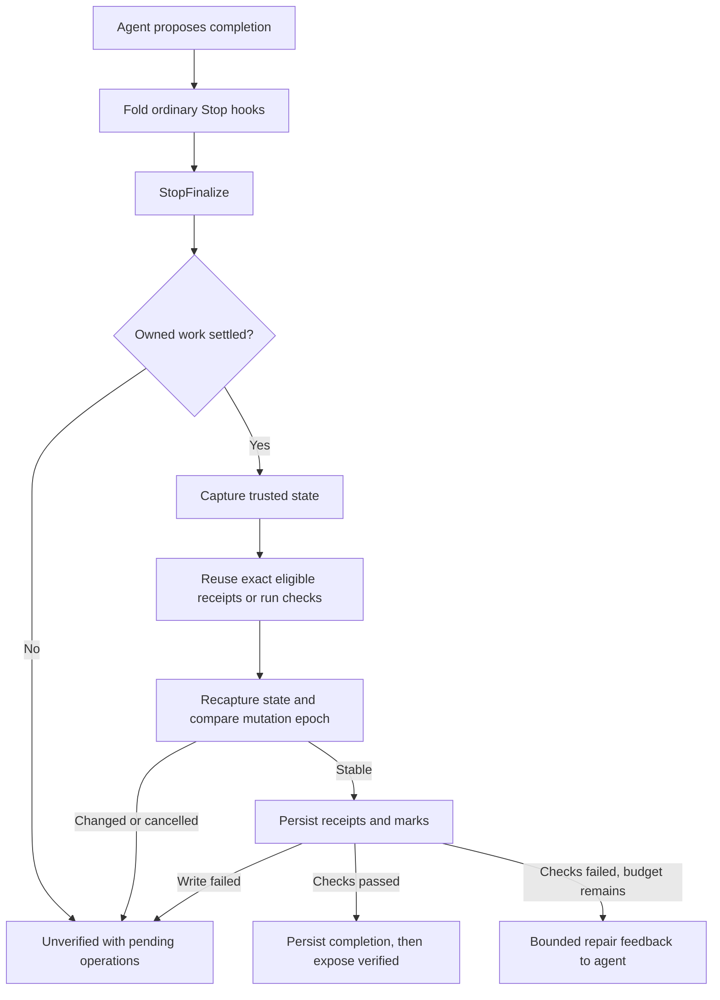

# Evidence-based completion for LibreChat Agents

The `src/verification/` module adds an opt-in completion boundary to the existing agent loop. The model still interprets the task and makes changes. The host declares checks, runs them, records evidence, and decides whether the registered requirements passed. No planner, judge model, specialist swarm or additional inference call is required.

`verified` means that the declared checks passed within their recorded scope. It does not prove that the checks fully describe the user's intent or that an agent-authored test is adequate. Quality, latency and cost improvements have not been benchmarked for this implementation.

## Acceptance contract

- Each run has its own attempt budget, pending operations and receipts. Reusing a gate across runs does not reuse another run's evidence.
- Already cancelled checks never start. Late passes after cancellation or timeout never become marks. An operation whose promise has not settled remains pending even after its deadline.
- Snapshot-aware admission compares state before and after the complete check set. A mutation notification, changed snapshot or unfinished operation prevents admission.
- Only explicitly eligible passing results can be reused. Failed checks, uncertain results and results without a snapshot provider are rerun.
- A failed evidence write is sticky. No marks are exposed as current completion after a persistence failure, including failure of the final `run_completed` write.
- Verification runs in `StopFinalize`, after ordinary Stop decisions have been combined. A planned continuation defers checks; prevented continuation ends unverified.
- Failed checks can request bounded repair turns. Pending jobs and unavailable snapshots end unverified without creating a model polling loop.
- Full returned verdicts remain in ledger artifacts. Model-visible diagnostics are bounded and explicitly disclose truncation.
- Successful admission seals new owned operations. A host must explicitly invalidate the run before admitting more work.



## Basic integration

Exports are available from `@librechat/agents`; no new package dependency is required.

```ts
import {
  HookRegistry,
  MemoryRunLedger,
  commandPasses,
  createCompletionGate,
  localCommandRunner,
} from '@librechat/agents';

const hooks = new HookRegistry();
const ledger = new MemoryRunLedger();
const gate = createCompletionGate({
  requirements: [{ mark: 'tests.pass', verifier: 'tests' }],
  verifiers: [commandPasses({
    id: 'tests',
    command: 'npm test -- --runInBand',
    runner: localCommandRunner({ workspace: { root: '/workspace/project' } }),
  })],
  ledger,
  maxAttempts: 3,
  maxFeedbackChars: 4000,
});
const unregister = gate.register(hooks);
```

Pass `hooks` through the existing `Run.create({ hooks, ... })` configuration. Read `gate.getCompletion(run.id)` after `processStream` settles and present an unverified result distinctly. Use the explicit run ID when sharing a gate. Call `unregister()` at registry teardown and `gate.releaseRun(run.id)` when the host no longer needs terminal state. Release refuses to forget active operations. Run IDs must identify unique execution lifetimes, not reusable conversation IDs.

The default still executes every declared check on each admitted evaluation. It adds no repository crawler or snapshot scan. `gate.hook(input, signal)` remains available for hosts with their own terminal boundary; these hosts must perform the same continuation folding as `Run` before calling it.

`register()` installs only a finalization hook. It preserves eager execution and prepared tool paths. Ordinary direct, event and approval tool flows remain owned by the existing Run/ToolNode lifecycle. A PreToolUse hook represents a proposal, including approval replay; it is not proof that a process started.

## Explicit background ownership

A tool that returns a process handle has not finished its underlying job. The host must register that job before launching it:

```ts
const settle = gate.beginOperation(runId, 'required-build');
try {
  await ownedBuildCompletion;
} finally {
  settle();
}
```

Here `ownedBuildCompletion` must resolve or reject only once the host knows the underlying execution stopped. A transport disconnection is insufficient. Register nested jobs against the owning root run when they must prevent that root's completion. IDs distinguish concurrent jobs; repeated registration of an active ID returns the same idempotent settlement function. A completed ID can be reused for a later job, and an old settlement function cannot settle that new job.

Operations invalidate retained evidence on both admission and settlement by default. The optional third `readOnly` argument is a trusted host declaration, never a model prediction. Read-only operations still prevent completion while pending. `gate.invalidate(runId)` covers external writes or uncertain state and clears current marks and receipts. It does not replace or edit the configured requirements.

An aborted local verifier kills its process tree through the existing execution engine and waits for the close event. Custom launchers must implement termination in their actual execution environment. In particular, killing a local SSH client is not proof that a remote job stopped. The durable Code API transport below supplies backend cancellation/reconciliation for matching workers. Other remote runners need their own ownership adapter.

## Safe reuse

Configure both a trusted `captureSnapshot(runId, signal)` callback and a verifier's `reuse` policy. Every reusable requirement needs a nonempty `version`; every reusable verifier needs a nonempty `reuse.version`.

```ts
const reusableTests = {
  ...commandPasses({ id: 'tests', command: trustedCommand, runner }),
  reuse: { version: trustedCheckDefinitionDigest, includeFinalText: false },
};
const requirement = { mark: 'tests.pass', verifier: 'tests', version: 'requirements-v2' };
```

The example variables are host configuration, not model-provided inputs. `captureSnapshot` returns:

| Field | Required coverage |
| --- | --- |
| `tenantId` | Authorization/tenant scope |
| `workspaceId` | Workspace identity, including execution incarnation where needed |
| `revision` | Immutable snapshot identity or a monotonic mutation token, including dirty and relevant untracked files |
| `environmentId` | Dependencies, configuration, runner/tool versions and any external state that can affect the check |

A Git commit hash, output digest or directory mtime alone is insufficient. Hashing a mutable tree twice is also insufficient if changes can occur and revert between observations. Use a host mutation epoch with complete write observation, or execute against the named immutable snapshot. The host must serialize competing writers during verification/admission if a mutable workspace is used. A callback alone cannot enforce that isolation.

An external service, clock, database, random input or mutable dependency cache that is not covered makes a check ineligible for reuse. Omit `reuse` for flaky or incompletely scoped checks. A snapshot capture failure, invalid identity or deadline ends verification unverified. It does not silently downgrade to an unscoped pass.

Checks that modify covered inputs will fail the before/after comparison. Run them against an immutable input view with a separate output directory, or explicitly include the resulting state in a fresh evaluation. Do not ignore relevant writes merely to make reuse succeed.

The cache key binds run ID, all four snapshot fields, requirement and verifier versions, configured params, verifier timeout, and final assistant text. Final text is included by default; `includeFinalText: false` is appropriate only when the verifier cannot depend on it. Configuration and params are copied when constructing the gate, and each invocation gets separate params. Change requirements or check definitions by constructing a new gate at a quiescent boundary with new versions.

A receipt records schema version, input hash, execution identity, check/requirement versions, snapshot, attempt and verdict. Only one candidate receipt per requirement is retained in memory. Receipts are admitted after the complete set observes stable state. Receipt and mark rows share content-addressed verdict blobs; a reused mark references the original receipt and explicitly records `reused: true`. Historical JSONL rows are never automatically loaded as authoritative cache entries after restart.

`CompletionState.snapshot` reports the state observed at admission. It is a point-in-time result. It does not promise that an external writer cannot change the workspace later; hosts must invalidate or compare identity before treating old completion as current.

## Evidence, context and trust

`MemoryRunLedger` and `JsonlRunLedger` retain canonical verdicts, including command output artifacts, independently of the feedback sent to the model. `ledger.blob(hash)` retrieves a content-addressed artifact; JSONL blobs are hash checked on read. Hosts can expose that operation through an authorized artifact reader. Failure feedback includes the artifact hash before diagnostic text so truncation does not hide the first retrieval handle. More failures may require reading the ledger's `verification_failed` rows.

Command artifacts retain returned stdout and stderr, an optional full-output path, and output completeness. Unknown completeness is represented as `null`; local or remote output caps do not become a claim of complete logs. The remote Code API's signature authenticates the returned execution record under its existing trust model. It does not establish a reusable workspace revision or semantic test coverage.

### Remote request binding

`codeApiVerdictRunner` binds each result to the complete submitted execution request, including optional `workspaceInstanceId`, `worktree`, `cwd`, `environmentAction` and `maxOutputBytes`. The host must supply the same target and authorization headers used by the agent's tools. The runner copies target configuration at construction. Requirements and commands remain host-defined.

The Code API signs two hashes: `request_sha256` covers the validated caller JSON without verdict metadata, before normalization; `dispatched_request_sha256` covers the actual dispatched JSON. The SDK rebuilds and compares the first hash. The server maps workspace instance IDs to the authenticated principal and may clamp timeouts, so the second hash is retained as a signed server statement rather than reconstructed by the client. This also means a hash is not proof that the server's normalization policy is correct. Authorization and worker selection remain the Code API's responsibility.

The consumer requires both hashes and rejects older unbound verdicts. Deploy the additive Code API signer changes before enabling this SDK runner. There is no silent fallback to command-only binding. Signatures, nonce, verifier ID, workspace, command, returned output and exit/timeout/signal/truncation fields are checked before accepting a result. A signed termination signal cannot pass merely because the response also reports exit code zero. Signed truncation becomes `outputComplete: false` in the retained artifact.

Key retrieval and optional asynchronous header providers receive the caller's abort signal. Only completed key lookups are cached, so cancelling one caller does not cancel another caller's in-flight lookup. Aborting an HTTP request still does not prove the remote command or its descendants stopped. A signed optional `process_settlement` claim binds the worker's explicit acknowledgement. The synchronous transport cannot recover a lost response; use the durable transport for remote ownership. Neither transport establishes a dirty-workspace revision or enables receipt reuse by itself.

## Durable remote verification

`createCodeApiVerificationSession(options)` reuses the same target selection and signature validation as `codeApiVerdictRunner`. It requires a `persist(record, signal)` callback that saves the recovery record in host-owned storage before any command submission. Records contain the request ID, original check request and nonce, and Code API base URL. They contain no authentication headers. Scope that storage to the authenticated principal and unique execution lifetime, outside the agent's write authority.

Use `session.runner` with `commandPasses`. The runner submits exactly once to `POST /workspace-tools/verify/requests` with a fresh `X-LibreChat-Workspace-Request-Id`. It observes the durable request through authenticated `GET /workspace-tools/requests/:requestId`. Server metadata binds every status to the caller request digest, verifier and nonce, including failed and never-started requests. The server's principal-mapped instance ID may differ from the caller's instance ID; the original request digest remains the binding.

There are two independent authorities: authenticated status establishes whether execution stopped; the signed verdict establishes whether the declared check passed. A rotated or unavailable signing key can reject verification after the server has correctly acknowledged process termination. That result releases execution ownership without admitting a mark. A signed result whose process-settlement claim disagrees with the returned result also fails verification.

| Durable execution state | Meaning | Ownership |
| --- | --- | --- |
| `not_started` | Explicit server record of a terminal transition before admission | May settle; cannot pass a check |
| `settled` | Worker explicitly acknowledged process-tree closure | May settle; a successful check still needs valid signed evidence |
| `unknown` | No authoritative termination acknowledgement | Retained, even if request state says completed, failed or cancelled |

The matching Linux worker emits `process_tree_exited` only through its production SRT launcher, with private PID namespace isolation and observed wrapper closure. This covers descendants that call `setsid` and redirect their output. The child executor propagates the proof across IPC, and the bridge negotiates whether the Code API accepts it. Injected test launchers, old workers and unsupported platforms do not acquire this guarantee. A server signature authenticates the worker report; it does not prove worker honesty.

Caller cancellation uses a new bounded signal to send `DELETE` and reconcile termination. HTTP requests, key validation and cancellation drain each have finite deadlines. Active monitoring also has a finite horizon, configurable with `monitorTimeoutMs`; its default covers the check timeout, the maximum server queue wait and cancellation grace. A lost response, missing request, expired assignment or exhausted reconciliation budget does not settle the runner's promise. The session keeps the request in `pending()`, and `CompletionGate` retains its unsettled verifier even after the hook returns unverified. This prevents both release and another verification attempt from forgetting work that may still run.

`reconcile(requestId, signal)` performs one bounded status lookup. `cancel(requestId, signal)` requests cancellation and inspects that response. Neither replays the command. After a process restart, `recover(record, signal)` restores the pending check from host storage and uses only status lookups. The host must register that recovered promise as owned work before admitting a new Run, using `beginOperation` and settling its handle only when that promise actually settles. Its returned outcome belongs to the original check; it is not a fresh check or evidence for a new workspace revision. A missing or expired durable record remains unresolved. There is no automatic unsafe release or retry-as-new-command fallback.

Deploy the Code API, matching worker and SDK together before selecting this transport. The service capability `durableWorkspaceVerification` establishes support for durable requests and signing, not that every selected worker can prove process termination. A legacy or unsupported worker may return a terminal request with `executionState: unknown`. Do not enable this path for those workers. Workspace revisions, production host persistence/recovery wiring, and configured required checks remain separate integration requirements.

The benchmark entry rejects `json_file_valid` requirements with the remote engine. A file on the SDK host cannot establish that a different remote workspace contains valid JSON. Local-engine checks remain available; future remote artifact checks need an explicitly remote implementation and identity binding.

`registerLedgerHooks(registry, ledger)` remains optional for recording tool proposals/results in addition to verification. Its timing keys include run and execution/agent identity. It installs result-altering hook categories and therefore disables the eager tool path under the existing registry rules. Use it when that audit trade-off is appropriate. Approval replays can produce multiple proposal rows; they must not be counted as multiple executions. Tool transcript rows are not the cache authority.

The authoritative store and snapshot source must be outside the agent executor's write authority. A JSONL file outside the repository is not sufficient isolation from a shell with the same unrestricted OS identity. Protect artifacts using the host's tenant access controls and redaction policy. This library change is not an OS security boundary.

## Compatibility and review boundaries

The existing API remains opt-in. Root exports and runner contracts are preserved with additive fields. `register()` now uses StopFinalize instead of Stop; callers manually registering `.hook` must supply an equivalent terminal ordering. Empty requirements retain the previous vacuous `verified: true` meaning, subject to pending work and stop guards when evaluated. It is not evidence that a run executed.

A timed-out callback that ignores cancellation now ends unverified and remains pending until it settles, instead of immediately scheduling another verifier against potentially changing state. Failure artifacts now carry complete structured verdicts instead of relying on large metadata fields. Consumers should retrieve artifacts rather than assume `metadata.details` is populated.

The initial gate changes have three review boundaries: gate/receipt semantics, cancellation in the existing local runner, and regression/integration coverage. There are no changes to model selection, graph topology, provider replay, public tool schemas, benchmark configurations or deployment. No benchmarks or paid-model runs were performed during that initial gate implementation.

The next integration step is a trusted LibreChat workspace adapter that can supply mutation epochs or immutable snapshots and persist/recover remote verification ownership through the durable transport. Enable receipt reuse only after that adapter's scope is verified. Adaptive reasoning, dependency-specific invalidation, cross-task memory and speculative execution remain research proposals; they are not represented as implemented or experimentally proven here.

## Initial gate validation record (2026-10-30)

- `npx jest src/verification/__tests__ src/hooks/__tests__ src/tools/__tests__/directToolHooks.test.ts src/tools/__tests__/ToolNode.eagerEventExecution.test.ts src/tools/__tests__/LocalExecutionTools.test.ts langfuse deterministic-trace-id --maxWorkers=2`: 28 suites and 651 tests passed. Run integration uses the repository's scripted test model. Cancellation coverage starts and terminates a real local child process.
- File-scoped ESLint over all 11 changed TypeScript files with `--max-warnings=0`: passed.
- `npx tsc --noEmit --incremental --tsBuildInfoFile node_modules/.cache/tsc/verification.tsbuildinfo -p tsconfig.json`: passed.
- `git diff --check` and authored punctuation checks: passed.

The whole repository suite and browser E2E were not run; the changed surface is library verification and process lifecycle, covered by the selected suites. Live provider calls, live Langfuse inspection and benchmarks were not run during the initial gate validation. Paid development diagnostics were authorized later and are recorded in the campaign report. Local execution tests print the existing unsandboxed-fixture warning; no validation command failed in the final run.

The implementation spans 12 files and approximately 1,800 changed lines, including tests and this document. Pre-existing benchmark edits were preserved. Before opening PRs, split the change into independently passing review units: local cancellation, gate/receipt behavior with its tests, and scoped ledger timing with documentation. No PR, deployment or benchmark campaign was started.

## Local programmatic lifecycle integration (2026-10-30)

The local Python and Bash bridges now dispatch `PermissionDenied`, `PostToolUse`, and `PostToolUseFailure` as well as `PreToolUse`. Hooks share the nested call identity and rewritten arguments. Successful output replacement includes an explicit `null`; policy denial remains distinct from execution failure. Requests denied before execution never invoke the nested tool. The bridge cannot suspend for interactive approval, so `ask` remains a denial.

Each accepted HTTP request owns an abort controller and a tracked promise. Parent cancellation, client disconnect, and shutdown cancel owned work; shutdown closes admission and connections, then waits for the accepted handlers. Runtime timeout terminates the interpreter and drains its outstanding bridge requests. Completion hooks run after invocation settlement and are not suppressed by the cancelled request signal. If a tool completes successfully despite cancellation, its ledger records the successful operation. The outer runner still reports cancellation.

Owned local process tools use `DynamicStructuredTool` through `createAwaitedTool`. This preserves callback parentage and runnable context without the installed LangChain `tool()` helper's early-reject signal race. An internal capability marks tools whose invocation promise represents cleanup completion. Only those tools receive a cancellation signal. Other nested tools run without an inherited signal and the bridge awaits their returned promises. An arbitrary external tool that detaches its own work or never settles cannot acquire a stronger lifetime guarantee from this adapter. Such tools need an explicit host adapter before relying on cancellation for bounded completion.

This guarantee applies to the owned tool invocation and bridge. An enclosing Runnable or graph can reject its caller early on cancellation; this patch does not redesign that boundary. Existing hook timeouts also remain in effect. No new background execution mode, speculative write behavior, approval protocol or snapshot adapter was added. Evidence reuse remains disabled in the development comparison.

The benchmark's `programmaticTools` flag adds both runners to the existing local allowlist. It leaves the same direct tools, task instructions, effort, output cap and gate settings in place. Added tool descriptions and the programmatic manifest are part of the treatment. `lcr-budget-ptc` is compared with `lcr-budget-gate`.

The final local check passed 17 suites and 539 tests, including 30 new bridge cases, existing caller-policy/direct-tool cases, and Langfuse/deterministic-trace fixtures. It covers real Bash/Python processes, timeout, abort, disconnect, delayed cleanup, denial, validation errors, output filtering, late-abort success, and nested callback parentage. File-scoped ESLint and incremental root TypeScript passed. The development task selftest confirmed that the original fixture fails and its reference solution passes. No browser or full-repository suite was run for this backend change. No live Langfuse project was inspected; tracing evidence is from local callback and existing export/routing fixtures.
